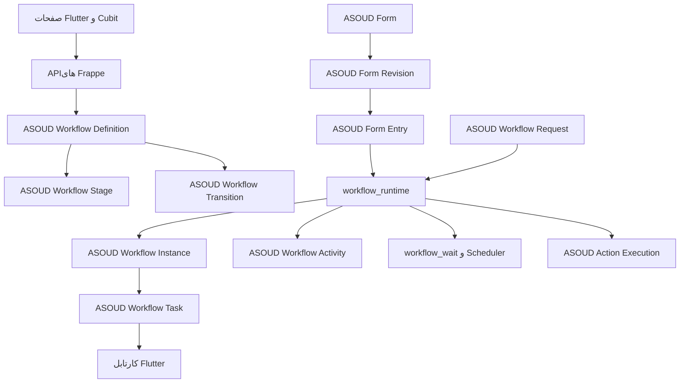

# ۳۷ — معماری واقعی، API و مدل داده

تاریخ: ۱۴۰۵/۰۸/۲۳ = 2026-11-14؛ مبنای ممیزی: اپ `c324e9e`، بک‌اند `448855f`. این سند تلفیق شواهد پذیرفته‌شدهٔ A1 تا A6 با تقدم REVIEW-NOTES.md است. بررسی کد یا اجرای مجدد تست در A7 انجام نشده است. ارجاع فایل و خط، مربوط به مبنای ممیزی است.

## داوری تلفیقی معماری

موتور واقعی سروری وجود دارد: تعریف، مرحله و انتقال از نمونه، وظیفه و فعالیت جدا هستند. فرم‌ساز نسخهٔ منتشرشده و دادهٔ ثبت‌شده را نگه می‌دارد؛ runtime تصمیم و انتقال و تخصیص را انجام می‌دهد. عمومی‌بودن موتور به معنی پشتیبانی کامل UI و همهٔ اسناد نیست: نوع هدف در فرم ایجاد ثابت است، لیست HR محدود است و ایجاد سند و اقدامات خودکار عمدتاً به Material Request و Journal Entry محدودند.

نسخه‌های Frappe/ERPNext/HRMS و MariaDB/Redis در جدول نقل‌شده، شواهد پین CI هستند؛ نسخهٔ نصب‌شدهٔ سرور عملیاتی و فهرست apps نصب‌شده بررسی نشده است. Flutter/Dart محلی همان مقادیر گزارش‌شدهٔ A1 هستند و در A7 دوباره اندازه‌گیری نشده‌اند.

ادعای عمومی سلامت idempotency در A1 برای فرم Document استثنا دارد: نقص جدید request_key و خطای tuple در 45-findings.md ثبت شده‌اند. محل انتخاب ماژول/نوع موجودیت نیز باید با شواهد دقیق‌تر A2 تفسیر شود: کشوی مستقل در فرم ایجاد وجود ندارد. قفل ویرایش در همهٔ APIها یکسان نیست؛ استثنای add_workflow_stage و update_stage_positions را 43-security.md توضیح می‌دهد.




<!-- شواهد منقول از A1.md، خطوط 53 تا 163 -->
## ۲. گزارش ساختار فنی و نقشه معماری (بخش ۳ و خروجی ۳۷)

### ۲.۱. تطبیق نسخه‌های واقعی فناوری در برابر مراجع اولیه

بر اساس ممیزی سورس، فایل‌های تنظیمات محیطی و بیلد سرور:

| مؤلفه | نسخه اعلام‌شده اولیه در پلان | نسخه در فایل‌های پیکربندی پروژه | نسخه واقعی محیط اجرای ممیزی | مدرک فنی و خط فایل |
| :--- | :--- | :--- | :--- | :--- |
| **Flutter SDK** | `3.44.6` (پلان خطوط ۳ و ۱۰۳) | `3.47.1` (CI) / `>=3.4.0 <4.0.0` (pubspec) | `3.47.7` (channel stable) | `.github/workflows/flutter.yml:9` و `pubspec.yaml:6` |
| **Dart SDK** | `3.12.2` (پلان خطوط ۳ و ۱۰۳) | `>=3.4.0 <4.0.0` (pubspec) | `3.13.5` (stable, macos_arm64) | خروجی دستور `dart --version` و `pubspec.yaml:6` |
| **Frappe Framework** | Frappe v15 | branch `version-15` | v15 (پین گیت) | `.github/workflows/erpnext-v15-integration.yml:83` |
| **ERPNext** | ERPNext v15 | branch `version-15` | v15 (پین گیت) | `.github/workflows/erpnext-v15-integration.yml:90` |
| **HRMS** | HRMS v15 | branch `version-15` | v15 (پین گیت) | `.github/workflows/erpnext-v15-integration.yml:91` |
| **Python** | `>=3.10` | `requires-python = ">=3.10"` / CI: `3.11` | Python 3.11 (CI) | `pyproject.toml:5` و `.github/workflows/backend.yml:20` |
| **MariaDB** | - | `mariadb:10.6` | 10.6 | `.github/workflows/erpnext-v15-integration.yml:34` |
| **Redis** | - | `redis:7-alpine` | 7-alpine | `.github/workflows/erpnext-v15-integration.yml:43` |
| **پکیج `asoud_erp`** | - | `version = "0.17.0"` | 0.17.0 | `pyproject.toml:3` |
| **کلاینت فلاتر** | - | `version: 0.30.0+51` | 0.30.0 | `flutter-asoud-erp/pubspec.yaml:4` |

---

### ۲.۲. پشته و معماری فرانت‌اند (`flutter-asoud-erp`)

1. **مدیریت State**: معماری BLoC/Cubit با استفاده از پکیج‌های `bloc: ^8.1.4` و `flutter_bloc: ^8.1.6`. کنترلرهای صفحات اصلی شامل:
   - `WorkflowListCubit` در `lib/features/workflows/presentation/cubit/workflow_list_cubit.dart`
   - `WorkflowFormCubit` در `lib/features/workflows/presentation/cubit/workflow_form_cubit.dart`
   - `WorkflowDesignerCubit` در `lib/features/workflows/presentation/cubit/workflow_designer_cubit.dart`
   - `WorkflowTasksCubit` در `lib/features/workflows/presentation/cubit/workflow_tasks_cubit.dart`
   - `WorkflowTaskDetailCubit` در `lib/features/workflows/presentation/cubit/workflow_task_detail_cubit.dart`
   - `WorkflowNotificationsCubit` در `lib/features/workflows/presentation/cubit/workflow_notifications_cubit.dart`
2. **مسیریابی (Routing)**: پیاده‌سازی‌شده با `go_router: ^14.6.2` در لایه هسته مسیریابی برنامه.
3. **لایه ارتباط با شبکه و نشست**:
   - کلاینت HTTP اصلی: `Dio: ^5.10.0` در `lib/core/network/frappe_client.dart` همراه با مدیریت کوکی نشست از طریق `cookie_jar: ^4.0.9` و `dio_cookie_manager: ^3.4.0`.
   - ذخیره‌سازی امن توکن‌ها و سشن: `flutter_secure_storage: 10.0.0` در `lib/core/auth/session_vault.dart`.
4. **فرم‌ساز پویا و اعتبارسنجی**: فرم‌های پویا در `lib/features/form_builder/` شامل ران‌تایم فرم (`form_runtime.dart`)، موتور اعتبارسنجی قوانین (`rules_engine.dart`) و موتور محاسباتی فرمول‌ها (`formula_engine.dart`).
5. **ویجت‌های اختصاصی و هویت بصری آسود**:
   - ویجت‌های فرم و کارت: `lib/core/widgets/asoud_ui.dart` و `lib/core/widgets/asoud_form.dart`
   - انتخاب تاریخ شمسی و تبدیل ارقام فارسی: `lib/core/widgets/asoud_jalali_picker.dart`، `lib/core/utils/jalali_date.dart` و `lib/core/utils/persian_format.dart`.
   - پالت رنگی تاییدشده آسود: `lib/core/theme/asoud_colors.dart`.
   - مدیریت وضعیت‌های خطا و بارگذاری: `lib/core/widgets/states.dart` و مدیریت خطای فارسی سرور در `lib/core/utils/failure_message.dart`.
6. **پشتیبانی موبایل و وب**: نرم‌افزار در وهله اول برای صفحات لمسی موبایل (عرض‌های ۳۲۰، ۳۹۰ و ۴۳۰ پیکسل در حالت RTL) طراحی شده و قابلیت اجرا روی وب و دسکتاپ با مکانیزم‌های تطبیقی در لایه ویجت‌ها را دارد.

---

### ۲.۳. ساختار بک‌اند و جاب‌های زمان‌بندی‌شده (`asoud_erp`)

ساختار بک‌اند بر اساس الگوی لایه‌بندی Frappe Framework طراحی شده است:
- لایه کنترلر Whitelisted در `asoud_erp/api/v1/*.py` که وظیفه اعتبارسنجی اولیه، بررسی گارد دسترسی و تبدیل پاسخ به پاکت `success(data, meta)` را دارد.
- لایه منطق خالص کسب‌وکار در `asoud_erp/services/*.py`.
- تعریف ساختار داده در `asoud_erp/asoud_erp/doctype/*/*.json`.

#### جاب‌های زمان‌بندی‌شده در سرور (`asoud_erp/hooks.py:59-66`)

| دوره زمانی | تابع فراخوانی‌شده | فایل پیاده‌سازی و وظیفه | رفتار در خطا و ایزولاسیون تراکنش |
| :--- | :--- | :--- | :--- |
| **daily** | `asoud_erp.api.v1.calendar.refresh_official_holidays` | `api/v1/calendar.py`: به‌روزرسانی تعطیلات تقویم رسمی | دارای `try/except` و ذخیره‌سازی لاگ خطا. |
| **cron (`* * * * *`)** | `asoud_erp.services.automatic_action_runtime.dispatch` | `services/automatic_action_runtime.py:504`: دیسپچ و اجرای صف اقدامات خودکار در وضعیت `Pending` یا `Retry Pending` | هر رکورد در savepoint مجزای `action_execution_dispatch` پردازش می‌شود؛ در خطا رول‌بک کرده و رکورد بعدی را ادامه می‌دهد. |
| **cron (`* * * * *`)** | `asoud_erp.services.workflow_wait.dispatch` | `services/workflow_wait.py:221`: بررسی و صف‌بندی مراحل انتظار (Wait) به صف پس‌زمینه | هر رکورد در savepoint مجزای `wait_dispatch_row` ارزیابی می‌شود؛ اما دارای ایراد اشباع صف است (یافته A1-004). |
| **cron (`* * * * *`)** | `asoud_erp.api.v1.calendar.dispatch_reminders` | `api/v1/calendar.py:236`: ارسال یادآوری‌های رویدادهای تقویم | دارای حلقه با ایزولاسیون خطا و ثبت لاگ. |
| **cron (`* * * * *`)** | `asoud_erp.api.v1.directives.dispatch_reminders` | `api/v1/directives.py:673`: ارسال یادآوری بخشنامه‌ها و وظایف | دارای حلقه با ایزولاسیون خطا و ثبت لاگ. |
| **hourly** | `asoud_erp.api.v1.workflow_runtime.process_workflow_deadlines` | `api/v1/workflow_runtime.py:1570`: بررسی مهلت‌های سررسید و تصاعد وظایف کارتابل | در savepoint مجزای `asoud_deadline_reminder` و `asoud_deadline_overdue` پردازش می‌شود؛ دارای ایراد کوئری بدون لیمیت است (یافته A1-013). |

---

### ۲.۴. نقشه جامع معماری سیستم (Page -> File -> API -> DocType)

تمامی مسیرهای فایل، توابع و متدهای کلاینت و سرور به صورت قطعی با دستور `ls` و `grep` در سورس‌کد تایید شده‌اند:

| صفحه / قابلیت کاربری | فایل فرانت‌اند (`lib/...`) | متد و خط فراخوانی در مخزن فرانت‌اند (`lib/...`) | متد Whitelisted و خط بک‌اند (`asoud_erp/api/v1/...`) | موجودیت (DocType) هدف در دیتابیس |
| :--- | :--- | :--- | :--- | :--- |
| **فهرست گردش کارها** | `lib/features/workflows/presentation/pages/workflow_list_page.dart` | `frappe_workflow_repository.dart:429` (`getWorkflows`) | `workflow.py:83` (`list_workflows`) | `ASOUD Workflow Definition` (خواندنی) |
| **تغییر وضعیت فعال/غیرفعال** | `lib/features/workflows/presentation/pages/workflow_list_page.dart:401` | `workflow_card_repository.dart:31` (`setStatus`) | `workflow.py:1144` (`set_workflow_status`) | `ASOUD Workflow Definition` (نوشتنی) |
| **حذف گردش کار** | `lib/features/workflows/presentation/pages/workflow_list_page.dart:399` | `workflow_card_repository.dart:47` (`delete` - فراخوانی مستقیم نیتیو) | `workflow.py:1166` (`delete_workflow` - بای‌پس‌شده) | `ASOUD Workflow Definition` (حذف) |
| **فرم ایجاد پیش‌نویس گردش کار** | `lib/features/workflows/presentation/pages/workflow_form_page.dart` | `frappe_workflow_repository.dart:25` (`createDraft`) | `workflow.py:188` (`create_workflow_draft`) | `ASOUD Workflow Definition`, `ASOUD Workflow Stage` |
| **دریافت گزینه‌های فرم تعریف** | `lib/features/workflows/presentation/pages/workflow_form_page.dart` | `frappe_workflow_repository.dart:288` (`getFormOptions`) | `workflow.py:148` (`workflow_form_options`) | `DocType`, `Company` (خواندنی) |
| **ویرایش اطلاعات متادیتای گردش کار** | `lib/features/workflows/presentation/pages/workflow_form_page.dart` | `frappe_workflow_repository.dart:390` (`saveRequestTypeInfo`) | `workflow.py:1105` (`update_request_type_info`) | `ASOUD Workflow Definition` (نوشتنی) |
| **صفحه طراحی و بوم Canvas** | `lib/features/workflows/presentation/pages/workflow_designer_page.dart` | `frappe_workflow_repository.dart:95` (`getDesign`) | `workflow.py:283` (`get_workflow_design`) | `ASOUD Workflow Definition`, `Stage`, `Transition` |
| **افزودن مرحله جدید روی بوم** | `lib/features/workflows/presentation/pages/workflow_designer_page.dart` | `frappe_workflow_repository.dart:108` (`addStage`) | `workflow.py:347` (`add_workflow_stage`) | `ASOUD Workflow Stage`, `Transition` |
| **درج مرحله بین دو مرحله (Split)** | `lib/features/workflows/presentation/pages/workflow_designer_page.dart` | `workflow_path_repository.dart:13` (`insert`) | `workflow.py:533` (`insert_workflow_stage`) | `ASOUD Workflow Stage`, `Transition` |
| **اتصال دو مرحله (Connect)** | `lib/features/workflows/presentation/pages/workflow_designer_page.dart` | `frappe_workflow_repository.dart:142` (`connectStages`) | `workflow.py:442` (`connect_workflow_stages`) | `ASOUD Workflow Transition` (نوشتنی) |
| **به‌روزرسانی مختصات گره‌ها روی بوم** | `lib/features/workflows/presentation/pages/workflow_designer_page.dart` | `frappe_workflow_repository.dart:158` (`updateStagePositions`) | `workflow.py:416` (`update_stage_positions`) | `ASOUD Workflow Stage` (نوشتنی) |
| **حذف مسیر و مراحل وابسته** | `lib/features/workflows/presentation/pages/workflow_designer_page.dart` | `workflow_path_repository.dart:27` (`remove`) | `workflow_paths.py:50` (`remove_path`) | `ASOUD Workflow Transition`, `Stage` (حذف) |
| **پیش‌نمایش حذف مسیر** | `lib/features/workflows/presentation/pages/workflow_designer_page.dart` | `workflow_path_repository.dart:25` (`preview`) | `workflow_paths.py:44` (`preview_path_removal`) | `ASOUD Workflow Stage`, `Transition` (خواندنی) |
| **تنظیمات مرحله شروع (Start)** | `lib/features/workflows/presentation/widgets/workflow_start_section.dart` | `frappe_workflow_repository.dart:196` (`saveStartSettings`) | `workflow.py:292` (`save_start_settings`) | `ASOUD Workflow Stage`, `Definition` |
| **تنظیمات مرحله اقدام کاربر و تأیید** | `lib/features/workflows/presentation/pages/stage_user_action.dart` و `stage_approval.dart` | `frappe_workflow_repository.dart:279` (`saveStageSettings`) | `workflow.py:833` (`save_stage_settings`) | `ASOUD Workflow Stage` (نوشتنی) |
| **تنظیمات مرحله شرط و مسیر** | `lib/features/workflows/presentation/pages/workflow_condition_settings.dart` | `workflow_condition_repository.dart:11` (`testCondition`) | `workflow.py:677` (`test_workflow_condition`) | - (تست بدون نوشتن) |
| **فیلدهای قابل استفاده در شرط** | `lib/features/workflows/presentation/pages/workflow_condition_settings.dart` | `workflow_condition_repository.dart:21` (`getFields`) | `workflow.py:612` (`workflow_condition_fields`) | `ASOUD Form`, `DocType` (خواندنی) |
| **افزودن شاخه شرطی (True/False)** | `lib/features/workflows/presentation/pages/workflow_condition_settings.dart` | `frappe_workflow_repository.dart:176` (`addConditionBranch`) | `workflow.py:731` (`add_condition_branch`) | `ASOUD Workflow Stage`, `Transition` |
| **تنظیمات اقدام خودکار (System Action)** | `lib/features/workflows/presentation/pages/automatic_action_page.dart` | `workflow_automation_repository.dart:180` (`save`) | `automatic_actions.py:126` (`save`) | `ASOUD Workflow Stage`, `Transition` |
| **گزینه‌های اقدام خودکار** | `lib/features/workflows/presentation/pages/automatic_action_page.dart` | `workflow_automation_repository.dart:239` (`options`) | `automatic_actions.py:37` (`options`) | `DocType`, `Role` (خواندنی) |
| **تنظیمات مرحله انتظار (Wait)** | `lib/features/workflows/presentation/pages/workflow_wait_settings_page.dart` | `workflow_wait_repository.dart:14` (`save_wait_settings`) | `workflow_wait.py:43` (`save_wait_settings`) | `ASOUD Workflow Stage` (نوشتنی) |
| **تنظیمات مرحله پایان (End)** | `lib/features/workflows/presentation/pages/workflow_end_settings_page.dart` | `frappe_workflow_repository.dart:279` (`saveStageSettings`) | `workflow.py:833` (`save_stage_settings`) | `ASOUD Workflow Stage` (نوشتنی) |
| **صفحه کارتابل وظایف** | `lib/features/workflows/presentation/pages/cartable_page.dart` | `frappe_workflow_task_repository.dart:51` (`listTasks`) | `workflow_runtime.py:954` (`list_my_workflow_tasks`) | `ASOUD Workflow Task` (خواندنی) |
| **صفحه فهرست وظایف سازمانی** | `lib/features/workflows/presentation/pages/workflow_tasks_page.dart` | `frappe_workflow_task_repository.dart:51` (`listTasks`) | `workflow_runtime.py:954` (`list_my_workflow_tasks`) | `ASOUD Workflow Task` (خواندنی) |
| **جزئیات و انجام وظیفه کارتابل** | `lib/features/workflows/presentation/pages/workflow_task_detail_page.dart` | `frappe_workflow_task_repository.dart:179` (`getTask`) | `workflow_runtime.py:1112` (`get_workflow_task`) | `ASOUD Workflow Task`, `Activity` |
| **تکمیل و تصمیم‌گیری وظیفه کارتابل** | `lib/features/workflows/presentation/pages/workflow_task_detail_page.dart` | `frappe_workflow_task_repository.dart:151` (`completeTask`) | `workflow_runtime.py:1367` (`complete_workflow_task`) | `ASOUD Workflow Task`, `Instance`, `Activity` |
| **ذخیره پیش‌نویس پاسخ وظیفه** | `lib/features/workflows/presentation/pages/workflow_task_detail_page.dart` | `frappe_workflow_task_repository.dart:284` (`saveDraft`) | `workflow_runtime.py:1234` (`save_workflow_task_draft`) | `ASOUD Workflow Task` (نوشتنی) |
| **آپلود پیوست وظیفه کارتابل** | `lib/features/workflows/presentation/pages/workflow_task_detail_page.dart` | `frappe_workflow_task_repository.dart:313` (`uploadAttachment`) | `workflow_runtime.py:1284` (`upload_workflow_attachment`) | `File` (نوشتنی) |
| **تأیید تحویل فیزیکی تجهیزات** | `lib/features/workflows/presentation/pages/workflow_task_detail_page.dart` | `receipt_confirmation_repository.dart:20` (`confirmReceipt`) | `request_followup.py:10` (`confirm_receipt`) | `ASOUD Workflow Task`, `Asset Movement` |
| **رد تحویل فیزیکی تجهیزات** | `lib/features/workflows/presentation/pages/workflow_task_detail_page.dart` | `receipt_confirmation_repository.dart:26` (`rejectReceipt`) | `request_followup.py:16` (`reject_receipt`) | `ASOUD Workflow Task`, `Asset Movement` |
| **ثبت درخواست عمومی** | `lib/features/workflows/presentation/pages/generic_request_page.dart` | `generic_request_repository.dart:372` (`createRequest`) | `workflow_request.py:578` (`create_request`) | `ASOUD Workflow Request`, `Instance` |
| **پیگیری و جزئیات درخواست** | `lib/features/workflows/presentation/pages/generic_request_page.dart` | `generic_request_repository.dart:126` (`get_request`) | `workflow_request.py:972` (`get_request`) | `ASOUD Workflow Request` (خواندنی) |
| **لغو درخواست توسط متقاضی** | `lib/features/workflows/presentation/pages/generic_request_page.dart` | `generic_request_repository.dart:126` (`cancel_request`) | `workflow_request.py:718` (`cancel_request`) | `ASOUD Workflow Request`, `Instance`, `Task` |
| **مشاهده جزئیات نمونه اجرا** | `lib/features/workflows/presentation/pages/workflow_instance_detail_page.dart` | `frappe_workflow_task_repository.dart:88` (`getInstance`) | `workflow_runtime.py:1009` (`get_workflow_instance`) | `ASOUD Workflow Instance` (خواندنی) |
| **فهرست فرم‌های عمومی** | `lib/features/form_builder/forms_page.dart` | `form_repository.dart:217` (`list`) | `forms.py:105` (`list_forms`) | `ASOUD Form` (خواندنی) |
| **طراحی و ذخیره اسکیما فرم** | `lib/features/form_builder/form_editor/editor_page.dart` | `form_repository.dart:190` (`save`) | `forms.py:220` (`save_form`) | `ASOUD Form`, `ASOUD Form Revision` |
| **تغییر وضعیت فرم (انتشار/بازبینی)** | `lib/features/form_builder/form_editor/editor_page.dart` | `form_repository.dart:272` (`transition`) | `forms.py:348` (`transition`) | `ASOUD Form`, `ASOUD Form Revision` |
| **ارسال ورودی فرم به گردش‌کار/سند** | `lib/features/form_builder/form_runtime/form_preview_page.dart` | `form_repository.dart:320` (`submit`) | `forms.py:636` (`submit_form`) | `ASOUD Form Entry`, `Instance`, نیتیو |

---


### ۲.۵. ردیابی گام‌به‌گام چرخه حیات گردش‌کار (Lifecycle Trace)

چرخه اجرای کامل سیستم از مرحله ثبت ورودی تا خاتمه و بایگانی با ذکر فایل، متد و خط کد به شرح زیر ردیابی شد:

```
[ثبت درخواست / سند] 
       │ (workflow_request.py:578 / forms.py:636)
       ▼
[تشخیص و تطبیق گردش کار]
       │ (workflow_submission_source.py:112 - route)
       ▼
[ایجاد نمونه اجرای WFI]
       │ (workflow_runtime.py:867 - start_workflow_instance / وضعیت Running)
       ▼
[آغاز مرحله شروع Start]
       │ (workflow_runtime.py:378 - _activate_stage)
       ▼
[انتقال به گره بعدی و ارزیابی مسیر]
       │ (workflow_runtime.py:246 - _next_stage)
       ▼
[تخصیص مسئول و ایجاد وظیفه WFT]
       │ (workflow_runtime.py:495-525 / وضعیت Open در کارتابل کاربر)
       ▼
[اقدام انسانی کاربر در کارتابل]
       │ (workflow_runtime.py:1367 - complete_workflow_task)
       ▼
[ارزیابی شرط و تصمیم‌گیری مسیر]
       │ (workflow_condition.py:120 - evaluate_group)
       ▼
[اجرای خودکار System Action]
       │ (automatic_action_runtime.py:514 - dispatch & run)
       ▼
[مدیریت انتظار زمانی Wait]
       │ (workflow_wait.py:155 - schedule & cron dispatch)
       ▼
[پایان فرایند و ثبت فرجام End]
       │ (workflow_end.py:25 - finish / وضعیت Completed یا Rejected)
       ▼
[ثبت تاریخچه و ممیزی رویداد]
         (workflow_runtime.py:109 / داک‌تایپ ASOUD Workflow Activity)
```

1. **ثبت درخواست یا سند (Submit Request / Document)**:
   - درخواست توسط کاربر در `generic_request_page.dart` ثبت شده و متد `asoud_erp.api.v1.workflow_request.create_request` (`workflow_request.py:578`) فراخوانی می‌شود.
   - فرم‌ساز نیز از طریق `asoud_erp.api.v1.forms.submit_form` (`forms.py:636`) رکورد `ASOUD Form Entry` را در دیتابیس ثبت می‌کند.
2. **تشخیص گردش کار (Workflow Detection)**:
   - سرویس `asoud_erp/services/workflow_submission_source.py` تابع `route(doc, rev, values)` تعریف معتبر و متناظر `ASOUD Workflow Definition` را بر اساس شرکت، کلید الگو و منبع ثبت شناسایی می‌کند.
3. **ایجاد نمونه اجرا (Instance Creation)**:
   - تابع `workflow_runtime.py:708` (`start_workflow_instance`) نمونه را با وضعیت `Running` در داک‌تایپ `ASOUD Workflow Instance` ایجاد کرده و کلید ارجاع سند نیتیو یا درخواست را در فیلدهای `reference_doctype` و `reference_name` ثبت می‌کند (`workflow_runtime.py:867`).
4. **شروع مرحله (Start Stage)**:
   - متد `_activate_stage` در `workflow_runtime.py:378` مرحله آغازین فرایند (گره دایره‌ای سبز) را بارگذاری و بلافاصله مسیر خروجی آن را پیمایش می‌کند.
5. **انتقال به مرحله بعد (Transition to Next Stage)**:
   - تابع `_next_stage` در `workflow_runtime.py:246` جدول `ASOUD Workflow Transition` را کوئری گرفته و گره مقصد بعدی را بر اساس تصمیم یا اتصال پیش‌فرض استخراج می‌کند.
6. **تخصیص مسئول و ایجاد وظیفه کارتابل (Assignment & Task Creation)**:
   - توابع `_users_for_stage` در `workflow_runtime.py:137` و `workflow_user_action.py:110` کاربران واجد شرایط را بر اساس قوانین سازمانی (دپارتمان، نقش، مدیر مستقیم یا فرد منتسب) استخراج می‌کنند.
   - رکورد وظیفه در `ASOUD Workflow Task` با وضعیت `Open` و تاریخ انتساب در خطوط `workflow_runtime.py:495-525` درج می‌شود (`ignore_permissions=True`).
7. **اقدام انسانی و ثبت تصمیم کاربر (Human Action & Decision)**:
   - کاربر از طریق صفحه `workflow_task_detail_page.dart` متد `asoud_erp.api.v1.workflow_runtime.complete_workflow_task` (`workflow_runtime.py:1367`) را فراخوانی می‌کند.
   - وضعیت تسک به `Completed` یا `Rejected` تغییر یافته و زمان خاتمه و فیلدهای فرم تکمیلی در `response_json` ثبت می‌شود.
8. **ارزیابی شرط و انتخاب مسیر (Condition Evaluation)**:
   - در گره‌های نوع `Condition`، تابع `evaluate_group` در `asoud_erp/services/workflow_condition.py` مقادیر متغیرها را از فرم درخواست یا خروجی مراحل قبلی از طریق `workflow_condition_binding.py` تطبیق داده و خروجی باینری `True/False` تولید می‌کند (`workflow_runtime.py:394-409`).
9. **اجرای اقدام خودکار (System Action Execution)**:
   - گره‌های نوع `System Action` یک رکورد در `ASOUD Action Execution` با وضعیت `Pending` ایجاد می‌کنند (`automatic_action_runtime.py:514`) که توسط کرون سرور در پس‌زمینه اجرا و نتیجه آن ثبت می‌شود.
10. **اجرای انتظار و زمان‌بندی (Wait Stage Execution)**:
    - گره‌های نوع `Wait` وضعیت انتظار و موعد سررسید را در فیلد `wait_snapshot_json` و `wait_due_utc` داک‌تایپ نمونه ذخیره می‌کنند (`workflow_wait.py:155`) تا کرون سرور در موعد مقرر اجرای فرایند را بیدار و به مرحله بعد هدایت کند.
11. **پایان فرایند و ثبت فرجام (Process End & Finalization)**:
    - در صورت رسیدن به گره `End`، تابع `finish` در `asoud_erp/services/workflow_end.py:25` وضعیت نهایی نمونه اجرا را به `Completed`، `Rejected`، `Cancelled` یا `Failed` تبدیل کرده و تمامی وظایف باز باقی‌مانده را لغو (`Cancelled`) می‌کند.
12. **ثبت تاریخچه و رویدادنگاری (Audit History Logging)**:
    - در هر تغییر وضعیت، یک رکورد در `ASOUD Workflow Activity` با ذکر شناسه عامل (`actor`)، اکشن، لاگ تغییرات قبل و بعد (`change_json`) و زمان دقیق ذخیره می‌شود (`workflow_runtime.py:109`).

---

## ۳. ممیزی معماری و تفکیک مسئولیت‌ها (بخش ۴ و ۵)

### جدول ۳.۱: ممیزی بندبه‌بند معماری عمومی فرایندساز (بخش ۴)

| بند برنامه (بخش ۴) | وضعیت | مدرک فنی (فایل و خط کد) | تحلیل مهندسی و شرایط شکست (ورودی/وضعیت ناسازگار) |
| :--- | :---: | :--- | :--- |
| **۱. استقلال موتور از ماژول منابع انسانی** | **partial** | `asoud_erp/services/workflow_assignment.py:23-45` و `workflow_user_action.py:125-165` | لایه انتساب وظایف در موتور مستقیماً به جدول `tabEmployee` و ساختار دپارتمان ERPNext متکی است. در صورتی که کاربری اکانت سیستمی داشته باشد اما فاقد رکورد کارمند فعال در شرکت باشد، انتساب سازمانی با شکست یا لیست خالی مواجه می‌شود. |
| **۲. قابلیت استفاده در سایر ماژول‌ها** | **real** | `asoud_workflow_definition.json:16-24` و `workflow_runtime.py:774` | موتور به صورت عمومی فیلد `module_key` (شامل Purchase, Accounting, Sales, Inventory, Support, HR) و `target_doctype` را به رسمیت می‌شناسد و نمونه‌ها روی هر سند نیتیو استاندارد قابل راه‌اندازی هستند. |
| **۳. اتصال به درخواست‌ها** | **real** | `asoud_erp/api/v1/workflow_request.py:578` و داک‌تایپ `ASOUD Workflow Request` | اتصال دوطرفه کامل بین درخواست‌ها و نمونه‌های اجرا وجود دارد (`workflow_instance` در درخواست و `reference_name` در نمونه). |
| **۴. اتصال به اسناد نیتیو** | **real** | `workflow_runtime.py:708` (`start_workflow_instance`) و `forms.py:685` | موتور از طریق فیلدهای `reference_doctype` و `reference_name` مستقیماً به اسناد استاندارد متصل شده و اسناد نیتیو را اعتبارسنجی می‌کند. |
| **۵. اتصال به رکوردهای موجود** | **real** | `workflow_runtime.py:776` و `workflow_start_policy.py:64` | وجود سند با `frappe.db.exists` کنترل شده و از راه‌اندازی چندباره گردش‌کار فعال روی یک سند توسط `workflow_start_policy` محافظت می‌شود. |
| **۶. استفاده از فرم‌ساز عمومی** | **real** | `forms.py:220` (`save_form`) و `workflow.py:816-830` | مراحل تأیید و اقدام می‌توانند مستقیماً اسکیماهای فرم منتشرشده را از داک‌تایپ `ASOUD Form` بخوانند و به عنوان فرم تکمیلی متصل کنند. |
| **۷. استفاده از نقش‌ها و ساختار سازمانی** | **real** | `asoud_erp/api/v1/organization.py:44` و `workflow_user_action.py:110` | استفاده از جدول `tabRole` و چارت سازمانی دپارتمان‌ها پیاده‌سازی شده، اما وابستگی به کارمند در آن جاری است. |
| **۸. ارتباط با کارتابل** | **real** | `workflow_runtime.py:954` (`list_my_workflow_tasks`) و `workflow_tasks_page.dart` | وظایف به صورت رکوردهای مجزا در `ASOUD Workflow Task` با وضعیت `Open` ثبت شده و در کارتابل کاربر مقصد قابل فیلتر و اقدام هستند. |
| **۹. ثبت تاریخچه و سوابق** | **real** | داک‌تایپ `ASOUD Workflow Activity` و `workflow_runtime.py:109` | تمام تغییرات، ارجاعات و تصمیم‌گیری‌ها به صورت ساخت‌یافته همراه با جفت `before/after` در فیلد `change_json` ذخیره می‌شوند. |
| **۱۰. مدیریت نسخه و اسنپ‌شات** | **partial** | `asoud_workflow_definition.json:48` و `asoud_workflow_instance.json` | برای فرم‌ها نسخه فرم (`ASOUD Form Revision`) اسنپ‌شات دارد و مرحله Wait نیز اسنپ‌شات ورودی می‌گیرد، اما برای کل گراف گردش‌کار هیچ جدول یا ساختار فریز اسنپ‌شات وجود ندارد و نمونه‌های زنده به مراحل زنده متصل‌اند (یافته A1-007). |
| **۱۱. مدیریت خطا و تراکنش** | **partial** | `workflow.py:196`، `workflow_runtime.py:1370` و `workflow_wait.py:228` | استفاده از `savepoint` و رول‌بک در کنترلرها پیاده شده است، اما پیام‌های خطای سرور به زبان انگلیسی نشت می‌کنند و در برخی بخش‌ها ترولبک کامل انجام نمی‌شود (یافته A1-006). |
| **۱۲. کنترل اجرای تکراری (Idempotency)** | **real** | `workflow_request.py:590` (`fingerprint`) و `forms.py:648` | کنترل اثرانگشت ارسالی و شناسه `request_id` / `request_key` مانع از ثبت درخواست‌های تکراری در تراکنش‌های هم‌زمان یا ارسال مجدد شبکه می‌شود. |

---

### جدول ۳.۲: تفکیک مسئولیت‌ها میان اجزا (بخش ۵)

| بند برنامه (بخش ۵) | وضعیت | مسئولیت اصلی و مرز عملکرد | تحلیل مهندسی و تداخل‌های کشف‌شده |
| :--- | :---: | :--- | :--- |
| **۱. فرم‌ساز (`forms.py`)** | **real** | نگهداری اسکیما، نسخه فرم، انواع فیلد و اعتبارسنجی مقادیر ورودی. | فرم‌ساز نباید در منطق اجرای جریان کار دخالت کند؛ با این حال در تابع `submit_form` (`forms.py:660-680`) مستقیماً توابع راه‌اندازی گردش‌کار و کتابخانه درخواست را فراخوانی می‌کند. |
| **۲. کتابخانه درخواست‌ها و اسناد (`workflow_request.py`)** | **real** | نگهداری درخواست‌ها، پیوست‌ها، تبدیل به اسناد تجاری ERPNext. | مسئولیت ذخیره‌سازی داده‌های درخواست به درستی در `ASOUD Workflow Request` ایزوله است. |
| **۳. فرایندساز (`workflow.py` و `workflow_runtime.py`)** | **real** | مدیریت مراحل، اتصالات، قوانین گذار، ارزیابی شرط، دیسپچ اقدامات خودکار و ثبت کارتابل. | مسئولیت هدایت استیت‌ماشین را بر عهده دارد و مستقل از ظاهر فرم‌ها عمل می‌کند. |
| **۴. استفاده از اطلاعات معتبر فرم و موجودیت** | **real** | ارزیابی شرایط در `workflow_condition_binding.py:75` و استخراج فیلدها. | مقادیر معتبر ذخیره‌شده فرم توسط ریزالور موتور خوانده می‌شوند؛ تغییر نوع فیلد در فرم نسخه قبل توسط مکانیزم اعتبارسنجی شرط کنترل می‌شود. |
| **۵. صحت محل انتخاب نوع درخواست، نوع سند و قالب** | **real** | انتخاب در `workflow_form_page.dart` و ذخیره در `asoud_workflow_definition`. | نوع موجودیت و ماژول در سطح تعریف گردش کار و قالب در سطح شروع یا مراحل وابسته تنظیم می‌شود. |
| **۶. جلوگیری از ایجاد تنظیمات تکراری و متناقض** | **partial** | فیلدهای `source_form` و `source_revision` در تعریف و مرحله شروع. | در برخی صفحات (مانند `stage_approval.dart` و `workflow_start_section.dart`) تنظیم اتصال فرم به مرحله و گردش‌کار در دو محل به صورت موازی عرضه شده و نیازمند هماهنگی دستی است. |

---

## ۴. فهرست و جدول جامع APIهای Whitelisted (بخش ۲۵)

این جدول شامل **تمامی ۷۷ متد `@frappe.whitelist`** موجود در ۱۰ ماژول کلیدی گردش کار، فرم‌ساز و درخواست‌ها با ذکر دقیق‌ترین گارد امنیتی فراخوانی‌شده در کد است:

| فایل و خط | نام تابع | متدهای مجاز HTTP | پارامترهای ورودی (امضای واقعی) | گارد امنیتی فراخوانی‌شده در کد (فایل:خط) | کلیدهای خروجی | عملیات دیتابیس (DocType + نوع) | وابستگی‌ها و سرویس‌های فراخوانی‌شده |
| :--- | :--- | :---: | :--- | :--- | :--- | :--- | :--- |
| `workflow.py:83` | `list_workflows` | GET, POST | `search=None, status=None, company=None, order_by='modified desc'` | `require_roles(('System Manager', 'Accounts Manager', 'Accounts User', 'HR Manager'))` (`workflow.py:89`) | `items, total` | `ASOUD Workflow Definition`, `Stage` (Read) | `workflow_contract.py:serialize_workflow` |
| `workflow.py:148` | `workflow_form_options` | GET, POST | none | `require_roles(('System Manager', 'Accounts Manager', 'HR Manager'))` (`workflow.py:149`) | `modules, companies, categories` | `DocType`, `Company` (Read) | `MODULE_DOCTYPES` |
| `workflow.py:188` | `create_workflow_draft` | POST | `workflow_title, module_key, target_doctype, company=None, process_description=None, creation_mode='Custom', icon_key=None, color_hex=None, start_settings=None` | `require_roles(('System Manager', 'Accounts Manager'))` (`workflow.py:193`) | `name, workflow_code, workflow_title, ...` | `ASOUD Workflow Definition`, `ASOUD Workflow Stage` (Write) | `workflow_start_settings.py:save`, `make_autoname` |
| `workflow.py:283` | `get_workflow_design` | GET, POST | `definition: str` | `require_roles(('System Manager', 'Accounts Manager', 'Accounts User', 'HR Manager'))` (`workflow.py:284`) | `definition, stages, transitions, details` | `ASOUD Workflow Definition`, `Stage`, `Transition` (Read) | `_design_payload`, `design_details_summary` |
| `workflow.py:292` | `save_start_settings` | POST | `definition, trigger_type, initiator_roles, subject_source, pass_mode, settings, validate_only, company` | `require_roles(('System Manager', 'Accounts Manager'))` (`workflow.py:302`) | `stage_title, config_json, ...` | `ASOUD Workflow Stage`, `Definition` (Write) | `workflow_start_settings.py:save` |
| `workflow.py:347` | `add_workflow_stage` | POST | `definition: str, stage_type: str, after_stage: str` | `require_roles(('System Manager', 'Accounts Manager'))` (`workflow.py:348`) | `stage, transition, details` | `ASOUD Workflow Stage`, `Transition` (Write) | `STAGE_TITLES`, `generate_hash` |
| `workflow.py:416` | `update_stage_positions` | POST | `definition: str, positions: str \| dict` | `require_roles(('System Manager', 'Accounts Manager'))` (`workflow.py:418`) | `definition, stages, transitions, details` | `ASOUD Workflow Stage` (Write) | `_design_payload` |
| `workflow.py:442` | `connect_workflow_stages` | POST | `definition: str, from_stage: str, to_stage: str, action: str, condition=None` | `require_roles(('System Manager', 'Accounts Manager'))` (`workflow.py:450`) [گارد `assert_editable` فقط برای Condition] | `transition, details` | `ASOUD Workflow Transition` (Write) | `workflow_condition_binding.py:assert_editable` |
| `workflow.py:533` | `insert_workflow_stage` | POST | `definition: str, transition: str, stage_type: str, draft_edit: int = 0` | `require_roles(('System Manager', 'Accounts Manager'))` (`workflow.py:536`) [گارد `editable` فقط مشروط به `draft_edit=1`] | `stage, transitions, details` | `ASOUD Workflow Stage`, `Transition` (Write) | `workflow_paths.py:editable` |
| `workflow.py:612` | `workflow_condition_fields` | GET, POST | `definition: str, stage=None, value_field=None, value_source_kind=None, value_source_stage=None, query=None` | `require_roles(('System Manager', 'Accounts Manager', 'HR Manager'))` (`workflow.py:615`) | `fields` | `ASOUD Form`, `DocType` (Read) | `workflow_condition_binding.py:catalog` |
| `workflow.py:677` | `test_workflow_condition` | POST | `definition: str, stage: str, config: str \| dict, samples: str \| dict` | `require_roles(('System Manager', 'Accounts Manager', 'HR Manager'))` (`workflow.py:680`) | `result, evaluated_rules` | هیچ (محاسباتی خالص) | `workflow_condition.py:evaluate_group` |
| `workflow.py:731` | `add_condition_branch` | POST | `definition: str, condition_stage: str, stage_type: str, result: bool` | `require_roles(('System Manager', 'Accounts Manager'))` (`workflow.py:734`) | `stage, transition, details` | `ASOUD Workflow Stage`, `Transition` (Write) | `add_workflow_stage` |
| `workflow.py:833` | `save_stage_settings` | POST | `definition: str, stage: str, config: str \| dict` | `require_roles(('System Manager', 'Accounts Manager'))` (`workflow.py:838`) & `assert_editable` | `stage, details` | `ASOUD Workflow Stage` (Write) | `workflow_condition_binding.py:assert_editable` |
| `workflow.py:1012` | `save_stage_routes` | POST | `definition: str, stage: str, routes: str \| dict` | `require_roles(('System Manager', 'Accounts Manager'))` (`workflow.py:1018`) & `owner.check_permission('write')` | `stage, transitions, details` | `ASOUD Workflow Transition` (Write/Delete) | `_design_payload` |
| `workflow.py:1105` | `update_request_type_info` | POST | `name, workflow_title, short_title, process_description, request_category, icon_key, color_hex, show_in_request_list, allow_user_submission, module_key` | `require_roles(('System Manager', 'Accounts Manager'))` (`workflow.py:1111`) | `definition` | `ASOUD Workflow Definition` (Write) | `serialize_workflow` |
| `workflow.py:1144` | `set_workflow_status` | POST | `name: str, status: str` | `require_roles(('System Manager', 'Accounts Manager'))` (`workflow.py:1148`) & `doc.check_permission('write')` | `definition` | `ASOUD Workflow Definition` (Write) | `workflow_lifecycle.py:require_activation_ready` |
| `workflow.py:1166` | `delete_workflow` | POST | `name=None` | `require_roles(('System Manager', 'Accounts Manager'))` (`workflow.py:1170`) & `doc.check_permission('delete')` | `name, deleted: True` | `ASOUD Workflow Definition` (Delete) | `workflow_lifecycle.py:delete_definition` (در `on_trash`) |
| `workflow.py:1210` | `validate_workflow` | GET, POST | `definition: str` | `require_roles(('System Manager', 'Accounts Manager', 'Accounts User', 'HR Manager'))` (`workflow.py:1213`) | `is_valid, errors, warnings` | `ASOUD Workflow Stage`, `Transition` (Read) | `workflow_contract.py:activation_requirements` |
| `workflow.py:1226` | `simulate_workflow` | POST | `definition: str, decisions=None` | `require_roles(('System Manager', 'Accounts Manager', 'Accounts User', 'HR Manager'))` (`workflow.py:1229`) | `trace, final_status` | `ASOUD Workflow Stage`, `Transition` (Read) | شبیه‌ساز مسیر گراف |
| `workflow_request.py:531` | `request_options` | GET, POST | `company=None` | `require_company(company)` (`workflow_request.py:534`) | `request_types, priorities` | `ASOUD Workflow Definition`, `Company` (Read) | `_fields_by_name` |
| `workflow_request.py:566` | `request_field_options` | GET, POST | `company, field_type, txt='', item_code=None, scope=None, limit_start=0, limit_page_length=20` | `require_company(company)` (`workflow_request.py:570`) | `options` | جدول‌های استاندارد ERPNext (Read) | `request_lookup.py` |
| `workflow_request.py:578` | `create_request` | POST | `company, workflow_definition=None, subject='', request_id='', values='{}', priority='Normal', required_by=None, project='', department='', attachments='[]', template_key=None` | `require_company(company)` (`workflow_request.py:586`) & `_may_submit` (`workflow_request.py:611`) | `name, subject, status, workflow_instance, ...` | `ASOUD Workflow Request`, `Instance` (Write) | `workflow_runtime.py:start_workflow_instance` |
| `workflow_request.py:718` | `cancel_request` | POST | `name: str, reason: str = ''` | `_own_running_request(name)` (`workflow_request.py:724`: بررسی مالک و شرکت و اجرای فعال) | `request` | `ASOUD Workflow Request`, `Instance`, `Task` (Write) | `workflow_wait.py:lock_for_cancellation` |
| `workflow_request.py:749` | `update_request` | POST | `name: str, subject='', values='{}', attachments='[]', remove_attachments='[]'` | `_own_running_request(name)` (`workflow_request.py:753`: بررسی مالک و شرکت و اجرای فعال) | `request` | `ASOUD Workflow Request` (Write) | `request_attachments.py:parse_uploads` |
| `workflow_request.py:906` | `list_my_requests` | GET, POST | `company=None, template_key=None, status_group='all', search=None, page=1, page_length=20` | `require_company(company)` (`workflow_request.py:910`) [فیلتر بر اساس `owner=frappe.session.user`] | `items, total, page, total_pages` | `ASOUD Workflow Request` (Read) | `_detail` |
| `workflow_request.py:972` | `get_request` | GET, POST | `name: str` | `_readable_request(name)` (`workflow_request.py:975` فراخوانی `request_permission`) | `request` | `ASOUD Workflow Request` (Read) | `request_access.py:request_permission` |
| `workflow_request.py:980` | `list_request_comments` | GET, POST | `name: str, limit_start=0, limit_page_length=50` | `_readable_request(name)` (`workflow_request.py:984`) | `comments` | `Comment` (Read) | `request_comments.py` |
| `workflow_request.py:992` | `add_request_comment` | POST | `name: str, content: str = ''` | `_readable_request(name)` (`workflow_request.py:996`) | `comment` | `Comment` (Write) | `request_comments.py:add_comment` |
| `workflow_request.py:1001` | `get_attachment` | GET, POST | `name, thumbnail=0` | `_readable_request(request)` (`workflow_request.py:1004`) | فایل باینری/دانلود | `File` (Read) | `frappe.utils.file_manager` |
| `workflow_request.py:1022` | `get_certificate` | GET, POST | `name: str` | `certificate_permission(doc)` (`workflow_request.py:1025`) | PDF بایت | `File` (Read) | `form_execution/certificate_issue.py` |
| `workflow_request.py:1038` | `create_native_document` | POST | `name: str` | `require_roles(('System Manager', 'HR Manager', 'Purchase Manager'))` (`workflow_request.py:1041`) & `require_company` | `native_doctype, native_name, native_status` | اسناد استاندارد ERPNext (Write) | `request_templates/lifecycle.py:dispatch_native_document` |
| `workflow_request.py:1055` | `void_native_document` | POST | `name: str, reason: str = ''` | `require_roles(('HR Manager',))` (`workflow_request.py:1058`) & `require_company` | `native_status: Voided` | اسناد استاندارد ERPNext (Cancel) | `request_void_actions.py:void_document` |
| `workflow_request.py:1068` | `reissue_native_document` | POST | `name: str` | `require_roles(('HR Manager',))` (`workflow_request.py:1071`) & `require_company` | `native_doctype, native_name, native_status` | اسناد استاندارد ERPNext (Write) | `request_templates/lifecycle.py:dispatch_native_document` |
| `workflow_runtime.py:708` | `start_workflow_instance` | POST | `definition, subject, reference_doctype=None, reference_name=None, reason='', restart=0, request_id=None` | `require_company(workflow.company)` (`workflow_runtime.py:714`) & بررسی نقش‌های مجاز آغازگر | `name, subject, status, current_stage` | `ASOUD Workflow Instance`, `Activity` (Write) | `_activate_stage`, `_validate_request_id` |
| `workflow_runtime.py:954` | `list_my_workflow_tasks` | GET, POST | `status='Open', start=0, paged=False` | **فاقد گارد نقش صریح در ورودی کنترلر** (فیلتر SQL بر اساس `assigned_to=frappe.session.user`) | `items, total, next_cursor` | `ASOUD Workflow Task` (Read) | `directive_access.py:instance_clause` |
| `workflow_runtime.py:984` | `list_my_workflow_instances` | GET, POST | `status=None, start=0, paged=False` | **فاقد گارد نقش صریح در ورودی کنترلر** (فیلتر SQL بر اساس `started_by=frappe.session.user`) | `items, total, next_cursor` | `ASOUD Workflow Instance` (Read) | `directive_access.py:instance_clause` |
| `workflow_runtime.py:1009` | `get_workflow_instance` | GET, POST | `instance: str` | `_assert_instance_access(doc)` (`workflow_runtime.py:1012`) | `instance, activities, tasks` | `ASOUD Workflow Instance`, `Activity` (Read) | `request_access.py:workflow_record_permission` |
| `workflow_runtime.py:1053` | `list_my_workflow_notifications` | GET, POST | `unread_only=0` | **فاقد گارد نقش صریح در ورودی کنترلر** (فیلتر SQL بر اساس `for_user=frappe.session.user`) | `items` | `Notification Log` (Read) | `frappe.get_all` |
| `workflow_runtime.py:1079` | `mark_workflow_notification_read` | POST | `notification: str` | **فاقد گارد نقش صریح** (صرفاً بررسی `doc.for_user == frappe.session.user` در خط ۱۰۸۱) | `read: True` | `Notification Log` (Write) | `doc.save(ignore_permissions=True)` |
| `workflow_runtime.py:1112` | `get_workflow_task` | GET, POST | `task: str, candidate_query=None, candidate_start=0` | `_assert_task_owner(doc)` (`workflow_runtime.py:1115`) | `task, document, history, draft, response` | `ASOUD Workflow Task`, `Activity` (Read) | `directive_access.py:directive_for` |
| `workflow_runtime.py:1234` | `save_workflow_task_draft` | POST | `task: str, response: str \| dict, supplementary_values=None` | `_assert_task_owner(doc)` (`workflow_runtime.py:1238`) | `draft_saved: True` | `ASOUD Workflow Task` (Write) | `reject_generic` |
| `workflow_runtime.py:1284` | `upload_workflow_attachment` | POST | `task: str, filename: str, content_base64: str` | `_assert_task_owner(doc)` (`workflow_runtime.py:1288`) | `file_url, file_name` | `File` (Write) | `frappe.utils.file_manager:save_file` |
| `workflow_runtime.py:1367` | `complete_workflow_task` | POST | `task, action, comment='', response=None, assignee=None, supplementary_values=None` | `_assert_task_owner(original)` (`workflow_runtime.py:1372`) | `name, status, next_stage` | `ASOUD Workflow Task`, `Instance`, `Activity` (Write) | `_activate_stage`, `workflow_user_action.py` |
| `workflow_paths.py:44` | `preview_path_removal` | GET, POST | `definition: str, transition: str` | `editable(definition)` (`workflow_paths.py:45`: نقش مدیر سیستم یا حسابداری) | `stages, transitions, stage_labels, version` | `ASOUD Workflow Transition`, `Stage` (Read) | `plan`, `removal_plan` |
| `workflow_paths.py:50` | `remove_path` | POST | `definition: str, transition: str, version: int` | `editable(definition, lock=True)` (`workflow_paths.py:52`) | `definition, stages, transitions, details` | `ASOUD Workflow Transition`, `Stage` (Delete) | `_design_payload`, `_touch_workflow` |
| `workflow_paths.py:71` | `discard_inserted_stage` | POST | `definition: str, stage: str, original: str \| dict` | `editable(definition, lock=True)` (`workflow_paths.py:73`) & اعتبارسنجی تیکت رمزنگاری‌شده | `definition, stages, transitions, details` | `ASOUD Workflow Stage`, `Transition` (Delete/Write) | `frappe.utils.password:decrypt` |
| `workflow_templates.py:11` | `catalog` | GET, POST | `company, search='', module_key='', start=0, page_length=20, include_user=0` | `access(company)` (`services/workflow_templates.py:18`: نقش مدیر سیستم یا حسابداری و `require_company`) | `items, next_start` | `ASOUD Workflow Definition` (Read) | `services.workflow_templates:catalog` |
| `workflow_templates.py:16` | `create_from_template` | POST | `company, source, source_modified, workflow_title, process_description='', icon_key='hub', color_hex='#315CF5', start_settings=None` | `require_roles(('System Manager', 'Accounts Manager'))` (`workflow_templates.py:19`) & `require_company` | `name, workflow_title, ...` | `ASOUD Workflow Definition`, `Stage`, `Transition` (Write) | `services.workflow_templates:create_from_template` |
| `workflow_wait.py:24` | `get_wait_options` | GET, POST | `definition: str, stage: str` | `access(definition, stage)` (`workflow_wait.py:27`: نقش مدیر و `require_company`) | `time_zone, source_policy, available_fields, target_stage` | `ASOUD Workflow Stage`, `Company` (Read) | `waits.office_zone`, `waits.fields` |
| `workflow_wait.py:43` | `save_wait_settings` | POST | `definition: str, stage: str, config: str \| dict` | `access(definition, stage)` & `assert_editable(definition)` (`workflow_wait.py:46-51`) | `stage, details` | `ASOUD Workflow Stage` (Write) | `validate_design`, `save_stage_settings` |
| `forms.py:105` | `list_forms` | GET, POST | `company, kind='Request', manage=0` | `require_company(company)` (`forms.py:108`) [اگر `manage=1` باشد: `require_roles(DESIGNERS)`] | `items` | `ASOUD Form` (Read) | `_builtin_key`, `stage_form_catalog` |
| `forms.py:147` | `open_builtin` | POST | `company, key, manage=0` | `require_company(company)` (`forms.py:150`) [اگر `manage=1` باشد: `require_roles(DESIGNERS)`] | `form` | `ASOUD Form`, `Revision` (Write) | `hr_form_catalog`, `stage_form_catalog` |
| `forms.py:160` | `remove_builtin` | POST | امضای کامل در ورودی ثبت نشده | `require_roles(('System Manager',))` (`forms.py:163`) & `require_company(company)` | `name, removed: True` | `ASOUD Form` (Delete) | `hr_form_catalog`, `store` |
| `forms.py:174` | `copy_form` | POST | `company, name, title=None` | `require_roles(DESIGNERS)` (`forms.py:177`) & `require_company(company)` | `form` | `ASOUD Form`, `Revision` (Write) | `load`, `store` |
| `forms.py:203` | `get_form` | GET, POST | `name, manage=0, revision_name=None` | `load(name, edit=manage)` (`forms.py:204`) [اگر `manage=0`: `allowed(schema, company)`] | `form, schema, revision` | `ASOUD Form`, `ASOUD Form Revision` (Read) | `migrate_schema`, `revision` |
| `forms.py:220` | `save_form` | POST | `company, schema, name=None, expected_version=0, client_id=None` | `require_roles(DESIGNERS)` (`forms.py:223`) & `require_company(company)` | `name, draft_version, schema` | `ASOUD Form`, `ASOUD Form Revision` (Write) | `validate_schema`, `store` |
| `forms.py:348` | `transition` | POST | `name, action, expected_version, note=''` | `load(name, edit=True, lock=True)` (`forms.py:351`: نقش طراحان) | `name, draft_version, active_revision, ...` | `ASOUD Form`, `ASOUD Form Revision` (Write) | `validate_schema`, `store` |
| `forms.py:389` | `get_history` | GET, POST | `name` | `load(name, edit=True)` (`forms.py:390`: نقش طراحان و بررسی شرکت) | `items` | `ASOUD Form Revision` (Read) | `frappe.get_all` |
| `forms.py:395` | `get_validation` | GET, POST | `company, schema, values=None` | `require_company(company)` & `require_roles(DESIGNERS)` (`forms.py:398`) | `normalized_schema, value_errors` | هیچ (محاسباتی خالص) | `validate_schema`, `validate_values` |
| `forms.py:410` | `get_options` | GET, POST | `company` | `require_company(company)` & `require_roles(DESIGNERS)` (`forms.py:413`) | `workflow_fields, dynamic_sources` | `ASOUD Workflow Definition` (Read) | `workflow_request.py:_fields` |
| `forms.py:425` | `get_link_options` | GET, POST | `company, source, query='', form=None, filter_field=None, filter_value=None, exclude_self=0, task=None` | `require_company(company)` (`forms.py:431`) [گارد نقش طراح یا دسترسی کاربر به فرم] | `options, reason` | جدول‌های استاندارد ERPNext (Read) | `form_schema.py:SOURCES` |
| `forms.py:508` | `employee_schedule` | GET, POST | `company, from_date, to_date, employee=None, form=None, field=None` | `require_company(company)` (`forms.py:511`) & احراز کارمند | `schedule` | `Employee Schedule` (Read) | `hrms.hr.doctype.shift_request` |
| `forms.py:597` | `upload_file` | POST | `form, filename, content` | **فاقد گارد نقش صریح در ورودی کنترلر** (صرفاً بررسی `load(form)` و `allowed(schema)`) | `file_url, name` | `File` (Write) | `frappe.utils.file_manager:save_file` |
| `forms.py:636` | `submit_form` | POST | `name, revision_name, subject, values, request_key` | **فاقد گارد نقش صریح** (احراز از طریق `load(name)` و `allowed(schema, doc.company)`) | `name, reference_name, reference_doctype, workflow_instance` | `ASOUD Form Entry`, سند نیتیو (Write) | `workflow_submission_source.py:start` |
| `forms.py:724` | `list_my_entries` | GET, POST | `company` | `require_company(company)` (`forms.py:727`) [فیلتر `owner=frappe.session.user`] | `items` | `ASOUD Form Entry` (Read) | `frappe.get_all` |
| `forms.py:730` | `get_entry` | GET, POST | `name` | `require_company(entry.company)` (`forms.py:733`) & بررسی مالک یا نقش مدیر سیستم | `entry, schema, values` | `ASOUD Form Entry`, `Revision` (Read) | `frappe.get_doc` |
| `forms.py:760` | `execution_kinds` | GET, POST | none | `require_roles(DESIGNERS)` (`forms.py:763`) | `kinds` | هیچ (متادیتای ثابت کد) | `form_execution.EXECUTORS` |
| `automatic_actions.py:37` | `options` | GET, POST | `definition: str, stage: str` | `_access(definition, stage)` (`automatic_actions.py:40`: نقش مدیر و `require_company`) | `sources, actions, requests, service_user` | `ASOUD Workflow Definition`, `Stage` (Read) | `automatic_action_metadata.py:schemas` |
| `automatic_actions.py:126` | `save` | POST | `definition: str, stage: str, config: str \| dict, routes: str \| dict` | `_access(definition, stage)` (`automatic_actions.py:130`: نقش مدیر و `require_company`) | `stage, transitions, details` | `ASOUD Workflow Stage`, `Transition` (Write) | `workflow.py:save_stage_settings` |
| `request_followup.py:10` | `confirm_receipt` | POST | `task: str` | `_lock(task)` (`request_followup_runtime.py:120`: احراز مالک تسک، متقاضی درخواست و کارمند فعال) | `task, status, movement` | `ASOUD Workflow Task`, `Asset Movement` (Write) | `request_followup_runtime.py:confirm` |
| `request_followup.py:16` | `reject_receipt` | POST | `task: str, reason: str \| None = None` | `_lock(task)` (`request_followup_runtime.py:120`: احراز مالک تسک، متقاضی درخواست و کارمند فعال) | `task, status, movement` | `ASOUD Workflow Task`, `Asset Movement` (Write) | `request_followup_runtime.py:reject` |
| `document_templates.py:89` | `document_template_options` | GET, POST | `company: str, workflow: str \| None = None` | `require_roles(MANAGER_ROLES)` (`document_templates.py:91`) & `require_company(company)` | `modules, doctypes, sources` | `DocType`, `Company` (Read) | `TARGET_FIELDS` |
| `document_templates.py:127` | `document_template_link_options` | GET, POST | `company: str, target_type: str, txt: str = ''` | `require_roles(MANAGER_ROLES)` (`document_templates.py:129`) & `require_company(company)` | `options` | جدول‌های استاندارد ERPNext (Read) | `frappe.get_list` |
| `document_templates.py:152` | `list_document_templates` | GET, POST | `company: str, kind: str = 'custom', module: str \| None = None, status: str \| None = None` | `require_roles(MANAGER_ROLES)` (`document_templates.py:155`) & `require_company(company)` | `items` | `ASOUD Document Template` (Read) | `frappe.get_all` |
| `document_templates.py:178` | `get_document_template` | GET, POST | `name: str` | `require_roles(MANAGER_ROLES)` (`document_templates.py:180`) & `require_company(doc.company)` | `template` | `ASOUD Document Template` (Read) | `frappe.get_doc` |
| `document_templates.py:198` | `save_document_template` | POST | `company: str, template: str \| dict, name: str \| None = None, client_id: str \| None = None` | `require_roles(MANAGER_ROLES)` (`document_templates.py:200`) & بررسی نقش ماژول | `template` | `ASOUD Document Template` (Write) | `validate_template`, `serialize_template` |
| `document_templates.py:242` | `set_document_template_status` | POST | `name: str, status: str` | `require_roles(MANAGER_ROLES)` (`document_templates.py:244`) & `require_company(doc.company)` | `name, status` | `ASOUD Document Template` (Write) | `doc.save` |

---

## ۵. مدل دیتابیس، ساختار کامل DocTypeها و واژگان وضعیت (بخش ۲۶)

### ۵.۱. ساختار کامل فیلدهای ۱۱ داک‌تایپ مرتبط با فرایندساز و فرم‌ساز (استخراج قطعی از فایل‌های JSON)

هیچ فیلدی خلاصه یا کوتاه نشده و تمامی فیلدهای اسکیما از سورس استخراج شده‌اند:

#### ۱. `ASOUD Workflow Definition`
- **مسیر فایل**: `asoud_erp/asoud_erp/doctype/asoud_workflow_definition/asoud_workflow_definition.json`
- **قاعده نام‌گذاری**: `field:workflow_code`
- **جدول فرزند**: ندارد | **شاخص‌های کلیدی**: `workflow_code` (Unique)

| نام فیلد (`fieldname`) | نوع داده (`fieldtype`) | الزامی (`reqd`) | یکتا (`unique`) | مقصد ارجاع یا گزینه‌ها (`options`) | عنوان فارسی / توضیحات |
| :--- | :--- | :---: | :---: | :--- | :--- |
| `workflow_code` | Data | ۱ | ۱ | - | کد یکتای گردش کار (مانند `WF-1405-001`) |
| `workflow_title` | Data | ۱ | ۰ | - | عنوان گردش کار |
| `process_description` | Small Text | ۰ | ۰ | - | شرح فرایند |
| `company` | Link | ۰ | ۰ | `Company` | شرکت / دفتر کار |
| `module_key` | Select | ۱ | ۰ | `Purchase\nAccounting\nSales\nInventory\nSupport\nHR` | ماژول سازمانی |
| `creation_mode` | Select | ۱ | ۰ | `Custom\nTemplate` | نحوه ایجاد (سفارشی یا از الگو) |
| `target_doctype` | Link | ۱ | ۰ | `DocType` | سند هدف گردش کار |
| `frappe_workflow` | Link | ۰ | ۰ | `Workflow` | گردش کار متناظر فریمورک Frappe |
| `status` | Select | ۱ | ۰ | `Active\nInactive\nArchived` | وضعیت جاری تعریف گردش‌کار |
| `readiness_status` | Select | ۱ | ۰ | `Ready\nPending` | وضعیت آمادگی اجرایی |
| `pending_reason` | Small Text | ۰ | ۰ | - | دلیل معلق بودن آمادگی |
| `missing_requirements_json` | Long Text | ۰ | ۰ | - | لیست JSON نیازمندی‌های ناقص |
| `version_no` | Int | ۰ | ۰ | - | شماره نسخه تعریف |
| `steps_count` | Int | ۰ | ۰ | - | تعداد مراحل فرایند |
| `icon_key` | Data | ۰ | ۰ | - | شناسه آیکون نمایشی |
| `color_hex` | Data | ۰ | ۰ | - | کد رنگی هگزادسیمال |
| `short_title` | Data | ۰ | ۰ | - | عنوان کوتاه نمایشی |
| `request_category` | Select | ۰ | ۰ | `\nFinance\nHR\nPurchase\nIT\nGeneral\nOther` | دسته‌بندی موضوعی درخواست |
| `show_in_request_list` | Check | ۰ | ۰ | - | نمایش در فهرست درخواست‌ها |
| `allow_user_submission` | Check | ۰ | ۰ | - | امکان ثبت توسط کاربران عادی |
| `archived_on` | Datetime | ۰ | ۰ | - | تاریخ و زمان بایگانی |
| `template_key` | Data | ۰ | ۰ | - | کلید الگوی سیستمی مبنا |
| `template_version` | Int | ۰ | ۰ | - | نسخه الگوی مبنا |
| `is_system_template` | Check | ۰ | ۰ | - | نشانگر الگوی پیش‌فرض سیستمی |
| `source_form` | Link | ۰ | ۰ | `ASOUD Form` | فرم منبع متصل به گردش‌کار |
| `source_revision` | Link | ۰ | ۰ | `ASOUD Form Revision` | نسخه فرم منبع متصل |

---

#### ۲. `ASOUD Workflow Stage`
- **مسیر فایل**: `asoud_erp/asoud_erp/doctype/asoud_workflow_stage/asoud_workflow_stage.json`
- **قاعده نام‌گذاری**: `hash` | **جدول فرزند**: ندارد

| نام فیلد (`fieldname`) | نوع داده (`fieldtype`) | الزامی (`reqd`) | یکتا (`unique`) | مقصد ارجاع یا گزینه‌ها (`options`) | عنوان فارسی / توضیحات |
| :--- | :--- | :---: | :---: | :--- | :--- |
| `workflow_definition` | Link | ۱ | ۰ | `ASOUD Workflow Definition` | شناسه تعریف گردش کار والد |
| `stage_key` | Data | ۱ | ۱ | - | کلید یکتای مرحله |
| `stage_type` | Select | ۱ | ۰ | `Start\nUser Task\nApproval\nCondition\nSystem Action\nWait\nEnd` | نوع مرحله (هفت‌گانه) |
| `stage_subtype` | Data | ۰ | ۰ | - | زیرنوع اختصاصی مرحله |
| `stage_title` | Data | ۱ | ۰ | - | عنوان نمایشی مرحله |
| `sequence_no` | Int | ۱ | ۰ | - | شماره ترتیب خطی مرحله |
| `config_json` | Long Text | ۰ | ۰ | - | کانفیگ کامل مرحله به فرمت JSON |
| `configuration_status` | Select | ۱ | ۰ | `Pending\nComplete` | وضعیت تکمیل تنظیمات مرحله |
| `position_x` | Float | ۰ | ۰ | - | مختصات X روی بوم طراحی |
| `position_y` | Float | ۰ | ۰ | - | مختصات Y روی بوم طراحی |

---

#### ۳. `ASOUD Workflow Transition`
- **مسیر فایل**: `asoud_erp/asoud_erp/doctype/asoud_workflow_transition/asoud_workflow_transition.json`
- **قاعده نام‌گذاری**: `hash` | **جدول فرزند**: ندارد

| نام فیلد (`fieldname`) | نوع داده (`fieldtype`) | الزامی (`reqd`) | یکتا (`unique`) | مقصد ارجاع یا گزینه‌ها (`options`) | عنوان فارسی / توضیحات |
| :--- | :--- | :---: | :---: | :--- | :--- |
| `workflow_definition` | Link | ۱ | ۰ | `ASOUD Workflow Definition` | شناسه تعریف گردش کار والد |
| `from_stage` | Link | ۱ | ۰ | `ASOUD Workflow Stage` | مرحله مبدأ اتصال |
| `to_stage` | Link | ۱ | ۰ | `ASOUD Workflow Stage` | مرحله مقصد اتصال |
| `transition_label` | Data | ۰ | ۰ | - | برچسب نمایشی مسیر |
| `condition_json` | Long Text | ۰ | ۰ | - | شرایط مسیر (اکشن/نتیجه شرط) |
| `sequence_no` | Int | ۰ | ۰ | - | شماره ترتیب ارزیابی مسیر |

---

#### ۴. `ASOUD Workflow Request`
- **مسیر فایل**: `asoud_erp/asoud_erp/doctype/asoud_workflow_request/asoud_workflow_request.json`
- **قاعده نام‌گذاری**: `format:REQ-{#####}` | **جدول فرزند**: ندارد

| نام فیلد (`fieldname`) | نوع داده (`fieldtype`) | الزامی (`reqd`) | یکتا (`unique`) | مقصد ارجاع یا گزینه‌ها (`options`) | عنوان فارسی / توضیحات |
| :--- | :--- | :---: | :---: | :--- | :--- |
| `company` | Link | ۱ | ۰ | `Company` | شرکت ثبت‌کننده |
| `workflow_definition` | Link | ۱ | ۰ | `ASOUD Workflow Definition` | نوع فرایند متناظر درخواست |
| `request_type` | Data | ۱ | ۰ | - | عنوان نوع درخواست |
| `subject` | Data | ۱ | ۰ | - | موضوع درخواست |
| `priority` | Select | ۰ | ۰ | `Low\nNormal\nHigh\nUrgent` | اولویت درخواست |
| `required_by` | Date | ۰ | ۰ | - | مهلت مورد انتظار متقاضی |
| `project` | Data | ۰ | ۰ | - | پروژه مرتبط |
| `department` | Data | ۰ | ۰ | - | دپارتمان سازمانی متقاضی |
| `values_json` | Long Text | ۰ | ۰ | - | مقادیر فیلدهای پویا فرم درخواست |
| `attachments_json` | Long Text | ۰ | ۰ | - | لیست JSON متادیتای پیوست‌ها |
| `workflow_instance` | Link | ۰ | ۰ | `ASOUD Workflow Instance` | نمونه اجرای جاری در گردش کار |
| `status` | Select | ۱ | ۰ | `Draft\nSubmitted\nCompleted\nRejected\nCancelled` | وضعیت نهایی درخواست |
| `display_status` | Data | ۰ | ۰ | - | عنوان وضعیت نمایشی به کاربر |
| `request_id` | Data | ۰ | ۱ | - | شناسه کلاینت برای جلوگیری از ثبت تکراری |
| `request_fingerprint` | Data | ۰ | ۰ | - | اثرانگشت یکتای محتوای ارسالی |
| `template_key` | Data | ۰ | ۰ | - | کلید الگوی سیستمی |
| `template_version` | Int | ۰ | ۰ | - | نسخه الگوی سیستمی |
| `requester_employee` | Link | ۰ | ۰ | `Employee` | کارمند متقاضی در شرکت |
| `status_key` | Data | ۰ | ۰ | - | کلید برنامه‌ای وضعیت |
| `search_text` | Small Text | ۰ | ۰ | - | متن خلاصه‌شده برای جستجو |
| `native_doctype` | Data | ۰ | ۰ | - | نوع سند تجاری ایجادشده نیتیو |
| `native_name` | Data | ۰ | ۰ | - | شناسه سند تجاری ایجادشده نیتیو |
| `native_status` | Select | ۰ | ۰ | `\nPending\nCreated\nSkipped\nFailed\nNeeds Review\nVoided` | وضعیت ایجاد سند تجاری نیتیو |
| `native_error` | Small Text | ۰ | ۰ | - | خطای ایجاد سند تجاری |

---

#### ۵. `ASOUD Workflow Instance`
- **مسیر فایل**: `asoud_erp/asoud_erp/doctype/asoud_workflow_instance/asoud_workflow_instance.json`
- **قاعده نام‌گذاری**: `format:WFI-{YYYY}-{#####}` | **جدول فرزند**: ندارد

| نام فیلد (`fieldname`) | نوع داده (`fieldtype`) | الزامی (`reqd`) | یکتا (`unique`) | مقصد ارجاع یا گزینه‌ها (`options`) | عنوان فارسی / توضیحات |
| :--- | :--- | :---: | :---: | :--- | :--- |
| `workflow_definition` | Link | ۱ | ۰ | `ASOUD Workflow Definition` | تعریف گردش کار اجراشده |
| `subject` | Data | ۱ | ۰ | - | موضوع نمونه اجرا |
| `reference_doctype` | Link | ۰ | ۰ | `DocType` | نوع سند مرجع تحت گردش کار |
| `reference_name` | Dynamic Link | ۰ | ۰ | `reference_doctype` | شناسه سند مرجع تحت گردش کار |
| `status` | Select | ۱ | ۰ | `Running\nCompleted\nRejected\nCancelled\nFailed` | وضعیت اجرای فرایند |
| `current_stage` | Link | ۰ | ۰ | `ASOUD Workflow Stage` | مرحله فعلی فرایند |
| `started_by` | Link | ۰ | ۰ | `User` | کاربر آغازکننده فرایند |
| `started_on` | Datetime | ۰ | ۰ | - | تاریخ و زمان دقیق شروع |
| `completed_on` | Datetime | ۰ | ۰ | - | تاریخ و زمان دقیق خاتمه |
| `wait_due_utc` | Datetime | ۰ | ۰ | - | موعد سررسید انتظار در زمان‌بند UTC |
| `wait_snapshot_json` | Long Text | ۰ | ۰ | - | اسنپ‌شات وضعیت انتظار فرایند |

---

#### ۶. `ASOUD Workflow Task`
- **مسیر فایل**: `asoud_erp/asoud_erp/doctype/asoud_workflow_task/asoud_workflow_task.json`
- **قاعده نام‌گذاری**: `format:WFT-{YYYY}-{#####}` | **جدول فرزند**: ندارد

| نام فیلد (`fieldname`) | نوع داده (`fieldtype`) | الزامی (`reqd`) | یکتا (`unique`) | مقصد ارجاع یا گزینه‌ها (`options`) | عنوان فارسی / توضیحات |
| :--- | :--- | :---: | :---: | :--- | :--- |
| `directive_kind` | Select | ۰ | ۰ | `\nReport\nReview\nClose` | نوع تسک بخشنامه (در صورت وجود) |
| `directive_subject_task` | Link | ۰ | ۰ | `ASOUD Workflow Task` | وظیفه گزارش مبنای بخشنامه |
| `workflow_instance` | Link | ۱ | ۰ | `ASOUD Workflow Instance` | نمونه اجرای والد وظیفه |
| `workflow_stage` | Link | ۱ | ۰ | `ASOUD Workflow Stage` | مرحله متناظر وظیفه |
| `task_title` | Data | ۱ | ۰ | - | عنوان وظیفه کارتابل |
| `assigned_to` | Link | ۱ | ۰ | `User` | کاربر منتسب‌شده در کارتابل |
| `status` | Select | ۱ | ۰ | `Open\nCompleted\nRejected\nCancelled` | وضعیت وظیفه کارتابل |
| `draft_json` | Long Text | ۰ | ۰ | - | پیش‌نویس پاسخ کاربر به فرم |
| `response_json` | Long Text | ۰ | ۰ | - | پاسخ نهایی ثبت‌شده کاربر |
| `action` | Data | ۰ | ۰ | - | نوع اقدام کاربر (تأیید، رد، بازگشت...) |
| `comment` | Small Text | ۰ | ۰ | - | دلیل یا نظر ثبت‌شده اقدام |
| `assigned_on` | Datetime | ۰ | ۰ | - | تاریخ و زمان واگذاری وظیفه |
| `due_on` | Datetime | ۰ | ۰ | - | موعد سررسید انجام وظیفه |
| `reminder_on` | Datetime | ۰ | ۰ | - | زمان ارسال یادآوری |
| `reminder_sent_on` | Datetime | ۰ | ۰ | - | زمان ارسال موفق یادآوری |
| `escalated_on` | Datetime | ۰ | ۰ | - | زمان تصاعد وظیفه به مدیر |
| `completed_on` | Datetime | ۰ | ۰ | - | تاریخ و زمان دقیق انجام اقدام |

---

#### ۷. `ASOUD Workflow Activity`
- **مسیر فایل**: `asoud_erp/asoud_erp/doctype/asoud_workflow_activity/asoud_workflow_activity.json`
- **قاعده نام‌گذاری**: `hash` | **جدول فرزند**: ندارد

| نام فیلد (`fieldname`) | نوع داده (`fieldtype`) | الزامی (`reqd`) | یکتا (`unique`) | مقصد ارجاع یا گزینه‌ها (`options`) | عنوان فارسی / توضیحات |
| :--- | :--- | :---: | :---: | :--- | :--- |
| `workflow_instance` | Link | ۱ | ۰ | `ASOUD Workflow Instance` | نمونه اجرای والد رویداد |
| `workflow_task` | Link | ۰ | ۰ | `ASOUD Workflow Task` | وظیفه مرتبط با رویداد |
| `workflow_stage` | Link | ۰ | ۰ | `ASOUD Workflow Stage` | مرحله وقوع رویداد |
| `actor` | Link | ۱ | ۰ | `User` | کاربر یا عامل ثبت رویداد |
| `action` | Data | ۱ | ۰ | - | عنوان اقدام ثبت‌شده |
| `comment` | Small Text | ۰ | ۰ | - | متن توضیحات رویداد |
| `change_json` | Long Text | ۰ | ۰ | - | تغییرات فیلدها قبل و بعد (JSON) |
| `created_on` | Datetime | ۱ | ۰ | - | زمان دقیق وقوع رویداد |
| `reference_doctype` | Link | ۰ | ۰ | `DocType` | نوع سند تولیدشده در این اقدام |
| `reference_name` | Dynamic Link | ۰ | ۰ | `reference_doctype` | شناسه سند تولیدشده |

---

#### ۸. `ASOUD Action Execution`
- **مسیر فایل**: `asoud_erp/asoud_erp/doctype/asoud_action_execution/asoud_action_execution.json`
- **قاعده نام‌گذاری**: `hash` | **جدول فرزند**: ندارد

| نام فیلد (`fieldname`) | نوع داده (`fieldtype`) | الزامی (`reqd`) | یکتا (`unique`) | مقصد ارجاع یا گزینه‌ها (`options`) | عنوان فارسی / توضیحات |
| :--- | :--- | :---: | :---: | :--- | :--- |
| `trigger_id` | Data | ۱ | ۰ | - | شناسه تریگر یکتا برای Idempotency |
| `workflow_instance` | Link | ۱ | ۰ | `ASOUD Workflow Instance` | نمونه اجرای گردش‌کار |
| `workflow_stage` | Link | ۱ | ۰ | `ASOUD Workflow Stage` | مرحله اقدام خودکار |
| `status` | Select | ۱ | ۰ | `Pending\nRunning\nRetry Pending\nSucceeded\nCompleted With Errors\nFailed\nCancelled` | وضعیت اجرای اقدام خودکار |
| `action_type` | Data | ۱ | ۰ | - | نوع عملیات خودکار |
| `config_json` | Code | ۱ | ۰ | `JSON` | اسنپ‌شات تنظیمات در زمان اجرا |
| `routes_json` | Code | ۱ | ۰ | `JSON` | اسنپ‌شات مسیرهای خروج |
| `attempts` | Int | ۰ | ۰ | - | تعداد دفعات تلاش برای اجرا |
| `next_attempt` | Datetime | ۰ | ۰ | - | زمان تلاش بعدی در صورت بروز خطای موقت |
| `started_on` | Datetime | ۰ | ۰ | - | زمان آغاز پردازش |
| `completed_on` | Datetime | ۰ | ۰ | - | زمان خاتمه پردازش |
| `service_user` | Link | ۰ | ۰ | `User` | کاربر سیستمی مجری عملیات |
| `result_json` | Code | ۰ | ۰ | `JSON` | نتایج خروجی عملیات به فرمت JSON |
| `error_code` | Data | ۰ | ۰ | - | کد خطای سیستمی |
| `error_message` | Small Text | ۰ | ۰ | - | متن خطای بازگشتی از سرویس |

---

#### ۹. `ASOUD Form`
- **مسیر فایل**: `asoud_erp/asoud_erp/doctype/asoud_form/asoud_form.json`
- **قاعده نام‌گذاری**: `hash` | **جدول فرزند**: ندارد

| نام فیلد (`fieldname`) | نوع داده (`fieldtype`) | الزامی (`reqd`) | یکتا (`unique`) | مقصد ارجاع یا گزینه‌ها (`options`) | عنوان فارسی / توضیحات |
| :--- | :--- | :---: | :---: | :--- | :--- |
| `title` | Data | ۰ | ۰ | - | عنوان فرم |
| `company` | Link | ۰ | ۰ | `Company` | شرکت صاحب فرم |
| `kind` | Select | ۰ | ۰ | `Request\nDocument\nStage` | نوع فرم (درخواست، سند نیتیو، مرحله) |
| `module_key` | Data | ۰ | ۰ | - | ماژول سازمانی |
| `draft_json` | Long Text | ۰ | ۰ | - | محتوای پیش‌نویس اسکیما (JSON) |
| `draft_version` | Int | ۰ | ۰ | - | نسخه پیش‌نویس |
| `active_revision` | Link | ۰ | ۰ | `ASOUD Form Revision` | نسخه منتشرشده و فعال فرم |
| `disabled` | Check | ۰ | ۰ | - | وضعیت غیرفعال بودن فرم |
| `pending_review` | Check | ۰ | ۰ | - | در انتظار بازبینی و تأیید |

---

#### ۱۰. `ASOUD Form Entry`
- **مسیر فایل**: `asoud_erp/asoud_erp/doctype/asoud_form_entry/asoud_form_entry.json`
- **قاعده نام‌گذاری**: `hash` | **جدول فرزند**: ندارد

| نام فیلد (`fieldname`) | نوع داده (`fieldtype`) | الزامی (`reqd`) | یکتا (`unique`) | مقصد ارجاع یا گزینه‌ها (`options`) | عنوان فارسی / توضیحات |
| :--- | :--- | :---: | :---: | :--- | :--- |
| `form` | Link | ۰ | ۰ | `ASOUD Form` | فرم مبنا |
| `revision` | Link | ۰ | ۰ | `ASOUD Form Revision` | نسخه فرم در زمان ارسال |
| `company` | Link | ۰ | ۰ | `Company` | شرکت ثبت‌کننده |
| `subject` | Data | ۰ | ۰ | - | موضوع ورودی |
| `values_json` | Long Text | ۰ | ۰ | - | مقادیر فیلدهای تکمیل‌شده (JSON) |
| `reference_doctype` | Data | ۰ | ۰ | - | نوع سند مرجع ایجادشده |
| `reference_name` | Data | ۰ | ۰ | - | شناسه سند مرجع ایجادشده |
| `request_key` | Data | ۰ | ۱ | - | کلید یکتای جلوگیری از ثبت مجدد |
| `fingerprint` | Data | ۰ | ۰ | - | اثرانگشت اطلاعات ارسالی |

---

#### ۱۱. `ASOUD Form Revision`
- **مسیر فایل**: `asoud_erp/asoud_erp/doctype/asoud_form_revision/asoud_form_revision.json`
- **قاعده نام‌گذاری**: `hash` | **جدول فرزند**: ندارد

| نام فیلد (`fieldname`) | نوع داده (`fieldtype`) | الزامی (`reqd`) | یکتا (`unique`) | مقصد ارجاع یا گزینه‌ها (`options`) | عنوان فارسی / توضیحات |
| :--- | :--- | :---: | :---: | :--- | :--- |
| `form` | Link | ۰ | ۰ | `ASOUD Form` | فرم والد |
| `version` | Int | ۰ | ۰ | - | شماره نسخه منتشرشده |
| `schema_json` | Long Text | ۰ | ۰ | - | محتوای فریز‌شده اسکیما فرم |
| `published_by` | Link | ۰ | ۰ | `User` | کاربر منتشرکننده |
| `published_on` | Datetime | ۰ | ۰ | - | تاریخ و زمان دقیق انتشار |
| `change_note` | Small Text | ۰ | ۰ | - | یادداشت تغییرات این نسخه |

---

### ۵.۲. واژگان وضعیت‌های ذخیره‌شده و خطوط انتساب در سورس‌کد

جدول زیر نشان می‌دهد هر مقدار وضعیت مجاز در کدام فایل و خط کد نوشته و ذخیره می‌شود:

| موجودیت و فیلد وضعیت | مقادیر مجاز وضعیت (Vocabulary) | معادل برچسب فارسی | فایل و خط کد ثبت‌کننده در سرور |
| :--- | :--- | :--- | :--- |
| **`ASOUD Workflow Definition.status`** | `Active` | فعال | `workflow.py:1152` و `workflow_lifecycle.py:38` |
| | `Inactive` | غیرفعال | `workflow.py:1152` و `workflow.py:246` (پیش‌نویس اولیه) |
| | `Archived` | بایگانی‌شده | `workflow.py:1152` و `workflow.py:1156` |
| **`ASOUD Workflow Instance.status`** | `Running` | در حال اجرا | `workflow_runtime.py:867` (تابع `start_workflow_instance`) |
| | `Completed` | تکمیل موفق | `workflow_end.py:42` (توسط outcome = Completed) |
| | `Rejected` | رد نهایی | `workflow_end.py:42` و `workflow_runtime.py:1522` |
| | `Cancelled` | لغوشده | `workflow_request.py:730` و `workflow_end.py:42` |
| | `Failed` | شکست‌خورده | `workflow_runtime.py:688`، `workflow_wait.py:147`، `automatic_action_runtime.py:460` |
| **`ASOUD Workflow Task.status`** | `Open` | باز / در انتظار اقدام | `workflow_runtime.py:504` (در زمان ایجاد وظیفه) |
| | `Completed` | انجام‌شده | `workflow_runtime.py:1487` (در `complete_workflow_task`) |
| | `Rejected` | رد‌شده | `workflow_runtime.py:1487` (در صورت انتخاب اقدام رد) |
| | `Cancelled` | لغوشده | `workflow_request.py:728` و `workflow_end.py:38` (لغو وظایف باز در پایان) |
| **`ASOUD Action Execution.status`** | `Pending` | در انتظار دیسپچ | `automatic_action_runtime.py:514` |
| | `Running` | در حال اجرا | `automatic_action_runtime.py:541` |
| | `Retry Pending` | در انتظار تلاش مجدد | `automatic_action_runtime.py:585` |
| | `Succeeded` | اجرای موفق | `automatic_action_runtime.py:563` |
| | `Completed With Errors` | تکمیل با خطا | `automatic_action_runtime.py:563` |
| | `Failed` | شکست نهایی | `automatic_action_runtime.py:585` |
| | `Cancelled` | لغوشده | `automatic_action_runtime.py:551` |
| **`ASOUD Workflow Request.status`** | `Draft` | پیش‌نویس | `workflow_request.py:657` |
| | `Submitted` | ارسال‌شده | `workflow_request.py:674` |
| | `Completed` | تکمیل‌شده | `workflow_request.py:838` (پس از خاتمه موفق نمونه) |
| | `Rejected` | رد‌شده | `workflow_request.py:838` (پس از رد نمونه) |
| | `Cancelled` | لغوشده | `workflow_request.py:733` (در `cancel_request`) |
| **فرجام مرحله پایان (`End Outcome`)** | `Completed` | تکمیل موفق | `workflow_end.py:42` (ثبت وضعیت `Completed` برای اینستنس) |
| | `Rejected` | رد نهایی | `workflow_end.py:42` (ثبت وضعیت `Rejected` برای اینستنس) |
| | `Cancelled` | لغو فرایند | `workflow_end.py:42` (ثبت وضعیت `Cancelled` برای اینستنس) |
| | `Stopped` | توقف فرایند | `workflow_end.py:42` (ثبت وضعیت `Failed` برای اینستنس) |

---


## قید بر جامعیت فهرست API

تعداد سطرهای جدول API در کنترل سند A7 برابر ۷۷ است و با عنوان A1 تطبیق دارد. عنوان بالای جدول جایگزین سطرهای غایب یا endpoint فرضی نمی‌شود. متد remove_builtin در یک سطر جدول A1 گارد را در جای امضای ورودی گذاشته و ستون‌ها کم هستند؛ امضای ورودی دقیق در این منبع کامل نیست؛ ستون مفقود با اعلام همین محدودیت تکمیل شده است. پاسخ خطا و مجوز دقیق هر endpoint در محیط زنده capture نشده و این فاصله در 46 ثبت شده است.

نتیجهٔ ادعای عمومی ایزولاسیون/گاردهای صحیح A1 باید با A1-005، A1-011 و A2-005 خوانده شود. وجود snapshot نسخهٔ فرم به معنی immutable بودن کل گراف اجرا نیست.

## ۷. نتایج مثبت تأییدشده بر اساس شواهد فنی (Positive Findings)

در جریان ممیزی عمیق سورس‌کد، رفتارهای صحیح و استانداردهای مهندسی قدرتمندی نیز مشاهده شد که به عنوان رفتار صحیح با مدرک فنی ثبت می‌شوند:

1. **اعمال اصولی تراکنش و Savepoint در تغییرات گراف**: در متدهای حساس مانند `discard_inserted_stage` (`workflow_paths.py:112`)، `save_start_settings` (`workflow_start_settings.py:82`) و `complete_workflow_task`، تغییرات داخل یک تراکنش اتمیک Frappe و `savepoint` محافظت می‌شوند تا در صورت بروز هرگونه خطا در زنجیره، پایگاه داده در وضعیت نیمه‌کاره رها نشود.
2. **بررسی اثرانگشت داده‌ها و جلوگیری از ارسال تکراری (Idempotency)**: متد `create_request` (`workflow_request.py:590`) از طریق هش SHA-256 مقادیر ورودی و کلید `request_id`، ارسال‌های تکراری ناشی از مشکلات شبکه را با دقت کنترل کرده و رکورد موجود را بازمی‌گرداند.
3. **ایزولاسیون کامل شرکت در لایه سرویس درخواست‌ها**: تابع `require_company(company)` به صورت پایدار در تمامی متدهای کتابخانه درخواست فراخوانی شده و کاربران به اطلاعات شرکت‌های دیگر دسترسی پیدا نمی‌کنند.
4. **تطبیق هندسه بصری مراحل با مستندات مرجع آسود**: پیاده‌سازی کلاس `WorkflowGraphGeometry` در فرانت‌اند (`workflow_graph_geometry.dart:12-45`) شکل‌های هفت‌گانه مصوب (دایره، مستطیل گوشه‌گرد، شش‌ضلعی، لوزی، متوازی‌الاضلاع، کپسول و هشت‌ضلعی) را با دقت و هماهنگی کامل با پالت رنگی آسود پیاده کرده است.
5. **جداسازی کامل نقش‌های سیستمی و مدیریت گردش‌کار**: در کنترلرهای طراحی و تغییر وضعیت (`workflow.py:188` و `1144`)، گارد `require_roles(('System Manager', 'Accounts Manager'))` مانع از دسترسی کاربران عادی به تنظیمات فرایندساز می‌شود.

---


